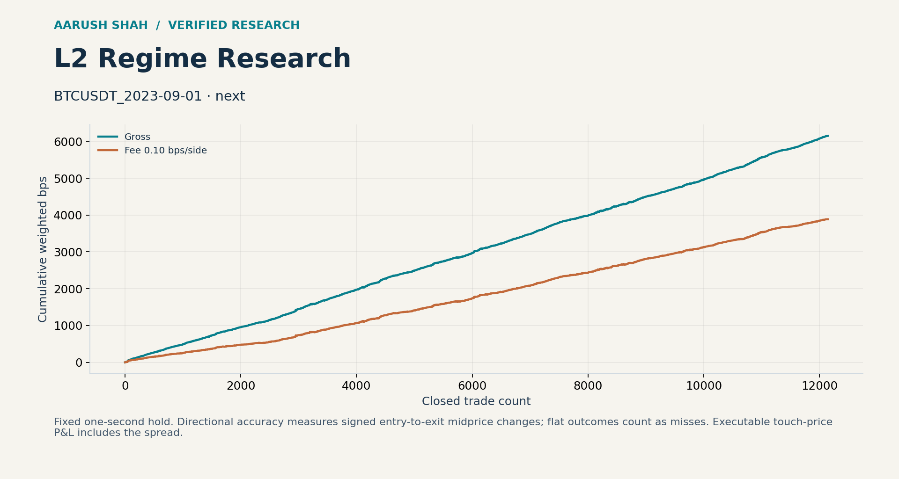

# L2 Market Microstructure & Direction Prediction

Research into how order-book states predict short-horizon price direction, and how that information interacts with entry timing, spreads and fees.

## Research highlights

- **81.96% directional hit rate** across **12,143 closed trades** on BTCUSDT (1 September 2023), using next-update entries and a fixed one-second hold.
- That BTC scenario also produced **+0.3200 mean net size-weighted bps per trade** and **61.06% net win rate**, at 0.10 bps per side.
- Compared next-update and 250 ms entry assumptions across BTC and GOOG to measure the persistence of predictive information.
- Independently reconstructed each closed-trade ledger and preserved the original 47-file research toolkit.

These are session-specific replay measurements. Directional hit rate measures the sign of side × (exit mid − entry mid) on closed trades; unchanged mids count as misses. It is a different target from executable net win rate.

## Explore the research

[Interactive research explorer](docs/explorer.html) — download the HTML and open it in a browser. GitHub displays its source. The explorer presents direction prediction alongside execution sensitivity.

## Historical experiment comparison

All rows use a one-second hold and a 0.10 bps-per-side fee scenario. P&L units are mean size-weighted bps per trade.

| Dataset | Entry | Closed trades | Directional hit | Gross mean | Net mean | Net win rate |
|---|---|---:|---:|---:|---:|---:|
| BTCUSDT 2023-09-01 | Next update | 12,143 | 81.96% | +0.5066 | +0.3200 | 61.06% |
| BTCUSDT 2023-09-01 | 250 ms | 11,243 | 40.80% | +0.1033 | -0.0842 | 30.10% |
| GOOG 2026-07-10 | Next update | 75 | 58.67% | -0.3149 | -0.5157 | 13.33% |
| GOOG 2026-07-10 | 250 ms | 73 | 46.58% | -0.8109 | -1.0118 | 9.59% |

The comparison quantifies how quickly the measured signal changes with execution timing. At the source's 4.5 bps-per-side fee stress, net P&L is negative in all four scenarios. Results characterize these sessions and assumptions; they do not estimate live or grid-wide performance.

## Data and methodology

BTC uses the Binance public archive checked against the provider SHA-256. The supplied GOOG session contains 985,948 updates; vendor metadata was not included. Nine fixed-seed synthetic instruments (10,000 snapshots each) provide controlled software experiments. Recovered TATAMOTORS and INFY arrays match the supplied simulator exactly and are labelled synthetic throughout. See [provenance comparison](verification/synthetic_provenance.json).

## Reproduce

~~~bash
python -m pip install -r requirements-verified.txt
python audit.py
python fetch_btc.py
python audit.py --replay data/binance/BTCUSDT_2023-09-01.npz --name BTCUSDT_2023-09-01
# With the first-passage repository alongside this one:
python audit.py --replay ../first-passage-research/data/goog/goog_2026-07-10.npz --name GOOG_2026-07-10
~~~

## Repository guide

- source/ and original_upload.zip: original toolkit and source hashes.
- verification/: per-trade ledgers, experiment summaries and provenance.
- data/: historical BTC and explicitly synthetic test inputs.
- docs/AUDIT.md: implementation review, accounting definitions and experiment scope.
- docs/explorer.html: project visualization.

Run python restore_large_files.py to reconstruct large inputs from checksum-verified byte parts listed in large_files.json. Original source and third-party attribution are retained; no new license is imposed.

